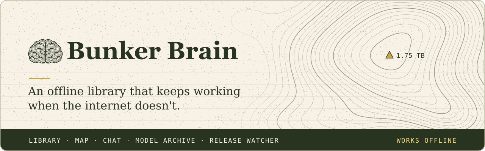
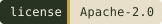
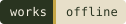
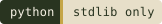
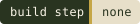
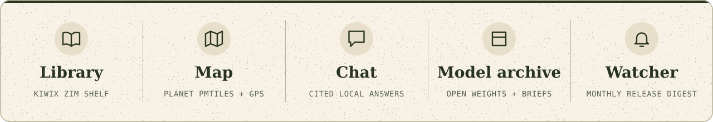
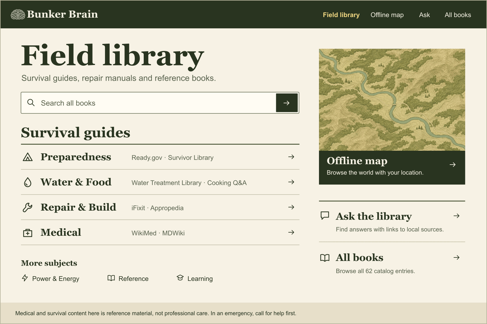
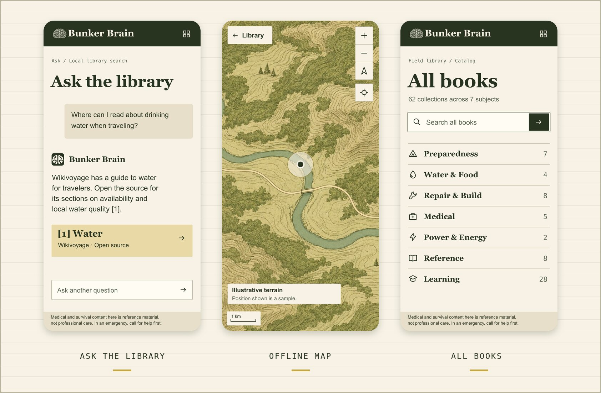

  

  
  
  
  

A self-hosted library for the day the internet goes quiet. It runs on a home
server and is reached from phones and laptops on the LAN or over a VPN: an
encyclopedia shelf, survival and repair manuals, a world map that follows your
GPS, and a local AI that answers from the books and cites its pages.

## What's inside

  

- **Library**: Wikipedia, its sister projects, and survival, repair and medical
  collections as Kiwix ZIM files, served by `kiwix-serve` behind a branded
  landing page.
- **Map**: a Protomaps planet PMTiles file with a MapLibre page that follows
  the phone's GPS.
- **Chat**: Open WebUI talking to local models, with a tool that searches the
  library and cites the pages it used.
- **Model archive**: curated open-weight models and their runtimes, each with a
  short brief, kept for offline use.
- **Release watcher**: a monthly script that reports new library, map, model
  and runtime releases to a webhook.

This repo holds code, config, manifests and docs only. No content or model
weights are committed or redistributed; you download them from their sources.
[WHATS-IN-IT.md](WHATS-IN-IT.md) lists the full set (about 1.75 TB), and
[SPEC.md](SPEC.md) explains the design and the choices behind it.

## A look around

  

   
  Screens from the Contour Atlas design kit.

> [!WARNING]
> Medical and survival content is reference material, not professional care.
> In an emergency, call for help first.

## Quick start

Needs Docker Compose (any host; it was built on a NAS managed with Dockge) and
a reverse proxy if you want HTTPS names.

1. Copy `stack/.env.example` to `stack/.env` and point `LIBRARY_DIR`,
   `MODELS_DIR` and `CONFIG_DIR` at your storage.
2. Copy `web/` into `$LIBRARY_DIR/web/`, and `web/links.example.json` to
   `$LIBRARY_DIR/web/links.json` with your own links.
3. Put ZIM files in `$LIBRARY_DIR/zim/` and the planet map as
   `$LIBRARY_DIR/maps/planet.pmtiles`. For large downloads use the aria2 stacks
   (`stack/fetch.compose.yaml` for one file, `stack/bulk.compose.yaml` with lists
   from `fetch/build_lists.py`): files are hash-checked before they move into place.
4. Start `stack/compose.yaml`. The site is on port 8791, Kiwix on 8790 and
   chat on 8792.
5. Open chat, create the first account (it becomes admin), turn off sign-ups,
   add a model connection, and install the library tool from
   [tools/README.md](tools/README.md).
6. For optional Codex or Claude Code subscription access in chat, follow the
   [Open Terminal setup](stack/open-terminal.md).

The release watcher is a single stdlib Python script run from cron; see
[watcher/README.md](watcher/README.md).

## Layout

| Path | What |
|---|---|
| `stack/` | Compose stacks: the site (Caddy, kiwix-serve, Open WebUI) and the download stacks |
| `web/` | Landing page, collections, map page; `web/brand/` is the design system; vendored JS and fonts |
| `stack/chat-brand/` | Open WebUI name, logo and theme, built from the same tokens |
| `tools/` | Open WebUI library-search tool |
| `watcher/` | Release watcher |
| `content/` | Library manifest and a dated safety quick reference for the chat's knowledge base |
| `fetch/` | Builds the aria2 download lists |

Everything is plain HTML/CSS/JS and standard-library Python, with no build
step, so it works fully offline. Tests: `python3 -m unittest` in `tools/`,
`watcher/`, `content/` and `web/`.

## Contributing

Read [AGENTS.md](AGENTS.md) first: it holds the house rules (nothing personal
in the repo, verify downloads by hash, pin sources, no Docker socket mounts).

## License

Apache License 2.0; see [LICENSE](LICENSE) and [NOTICE](NOTICE). Contributions
are accepted under the same license (section 5). Vendored files keep their own
licenses, listed in [web/vendor/README.md](web/vendor/README.md). Library
content, maps and models are not part of this repo and carry their sources'
licenses.

---

  <picture>
    <source media="(prefers-color-scheme: dark)" srcset="web/brand/app-icon-dark-180.png">
    
  </picture> 
  Built to sit on the shelf, not in the cloud.

